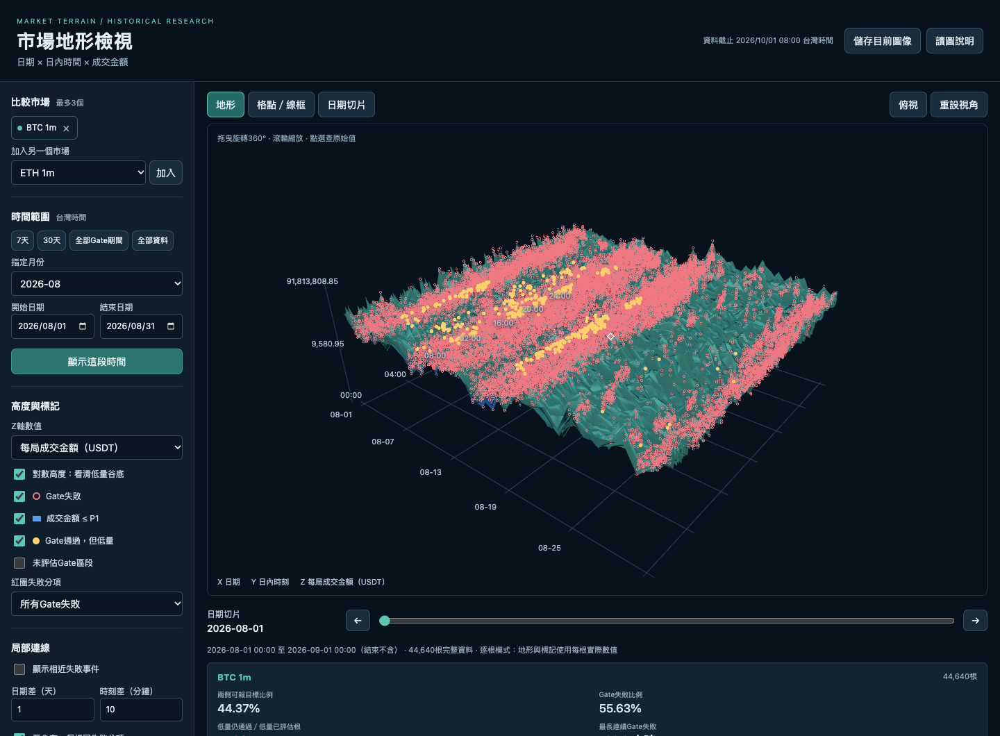

# Binance Trading Volume 3D Terrain Diagram

互動式市場地形圖，以「日期 × 日內時刻 × 成交額」觀察 Binance 歷史市場的熱門、冷量與研究 Gate 分項結果。

**[直接開啟線上工具](https://rolanthhuang.github.io/Binance_Trading_Volume_3D_Terrain_Diagram/)** · **[操作與判讀說明（PDF）](docs/terrain-guide-zh-TW.pdf)**

## 怎麼使用

1. 選擇幣種及每局週期，最多疊合三個市場。
2. 選擇月份、7 天、30 天或自訂日期範圍。
3. 切換「地形」「格點／線框」「日期切片」。拖曳旋轉，滾輪縮放；日期切片可用滑桿逐日查看。
4. 選擇每局成交額、每分鐘成交額、相對 P1 或成交筆數；點選地形或標記查原始數值。
5. 可顯示相近 Gate 失敗事件的局部連線，並匯出目前圖像。

紅圈表示研究 Gate 失敗；藍色表示成交額低於或等於固定 P1；黃色點表示 Gate 通過但成交額低量；白色菱形表示目前範圍最低值。

## 資料與判讀

- BTCUSDT、ETHUSDT、SOLUSDT、XRPUSDT、DOGEUSDT，各有 1～10 分鐘、15 分鐘與 1 小時，共 60 個市場。
- 成交資料為 2024-04-01 00:00 UTC 至 2026-10-01 00:00 UTC，結束不含。畫面日期及時刻使用台灣時間。
- 研究 Gate 評估為 2025-04-02 00:00 UTC 至 2026-10-01 00:00 UTC；更早區段標示未評估。
- P1 是每個市場完整 30 個月成交額的第 1 百分位，包含零成交；不隨目前觀看區間改變。
- 相對 P1 的 Z 軸＝該根成交額 ÷ 該市場固定 P1，單位為倍數。
- 長區間自動使用概覽格；高度採格內中位數，點選後可放大至逐根資料。

成交額是目標柱結束後的實際值，Gate 使用下注前可知資料；這是事後研究對照。Gate 通過不等於實際接單或市場安全證明。相近失敗點的連線也不代表因果關係。本工具不會下單或自動改動市場。

## 本機開啟

下載完整儲存庫 ZIP 並解壓縮，以近期 Chrome 或 Edge 開啟 `index.html`。需要 WebGL2 與瀏覽器 gzip 解壓縮支援；不需要 Python、Binance 帳號或 API 金鑰。

程式與 1,800 個月份資料檔均包含在此儲存庫。線上版只載入所選市場及月份；完整內容約 373 MB，GitHub ZIP 下載經壓縮後會較小。工具沒有分析追蹤或外部 API 請求。

## 檔案

- `index.html`、`app.js`、`styles.css`：介面與打包後的 Three.js／TSL WebGL2 繪圖程式。
- `catalogue.js`、`data/`：市場目錄及月份資料。
- `docs/terrain-guide-zh-TW.pdf`：操作與判讀說明。
- `THREE-LICENSE.txt`：Three.js 的第三方授權聲明。

此發布沿用地形工具 V1 的程式與資料，不包含交易平台後端、帳務、玩家模擬或資料庫程式。
